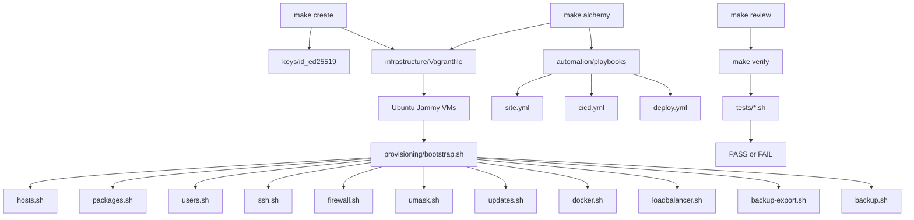
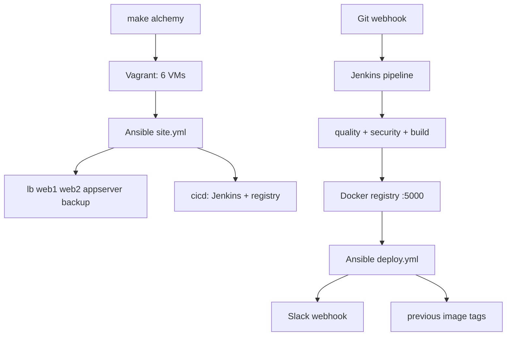
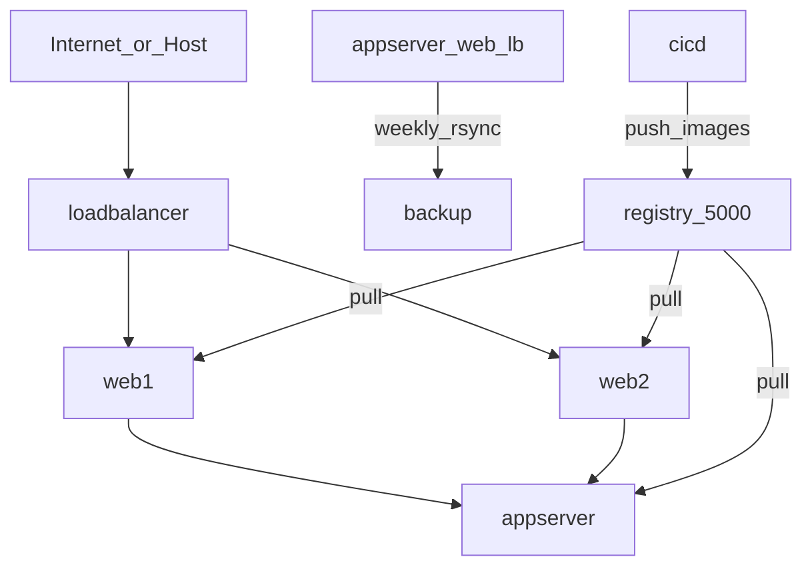

# Architecture

## Overview

Automation-VMs is a local multi-VM Ubuntu environment managed by Vagrant and VirtualBox. Automation lives in layered folders:

1. **Mandatory** — Ubuntu VMs with hostname, static IP, `devops`, SSH hardening, UFW, umask, auto-updates
2. **Automation** — Make + scripts: create / destroy / verify / review / app-deploy / backup
3. **Application** — Dockerized diagnostic frontend/backend behind nginx LB; dedicated backup host
4. **Alchemy (Phase 3)** — Ansible idempotent config + Jenkins CI/CD on `cicd` + local registry
5. **Portfolio** — web dashboard (`make dashboard`); opt-in stretch via `make stretch` (Fail2Ban, WireGuard, Netdata)

## Components

```text
Host (macOS / Linux / WSL)
  └── VirtualBox  (VM group: /Automation-Alchemy)
        └── Vagrant (infrastructure/Vagrantfile)
              ├── loadbalancer  10.10.0.10
              ├── web1          10.10.0.11
              ├── web2          10.10.0.12
              ├── appserver     10.10.0.20
              ├── backup        10.10.0.30
              └── cicd          10.10.0.40   (Jenkins + registry)
```

Topology diagram: [`assets/topology.svg`](../assets/topology.svg)

## Provisioning flow



## Alchemy CI/CD flow



## Traffic / roles



Browser → loadbalancer `:80` → web1/web2 frontend containers → `/api` → appserver `:3000`.  
Backup host pulls weekly snapshots of devops homes, `/etc`, and app-related data; restore is scripted (`make backup-restore`).  
Jenkins on `cicd` builds/pushes images to the local registry; deploy playbooks pull tags onto app hosts.

## Configuration sources

| File | Role |
|------|------|
| `infrastructure/machines.yml` | Hostnames, IPs, memory, CPUs, box (Vagrant) |
| `infrastructure/network.yml` | CIDR and hosts map passed into guests |
| `config/hosts` | `/etc/hosts` body (keep aligned with YAML) |
| `config/sshd_config` | SSH daemon drop-in template |
| `config/ufw.rules*` | Firewall allow list + per-role overlays |
| `config/nginx-lb*.conf` | Load balancer algorithms |
| `automation/` | Ansible inventory, roles, playbooks |
| `Jenkinsfile` | CI pipeline definition |

YAML stays the single source of truth for VM definitions. Guest templates that are copied onto disk live under `config/`. See [`docs/alchemy.md`](alchemy.md) for Phase 3 operator details.
